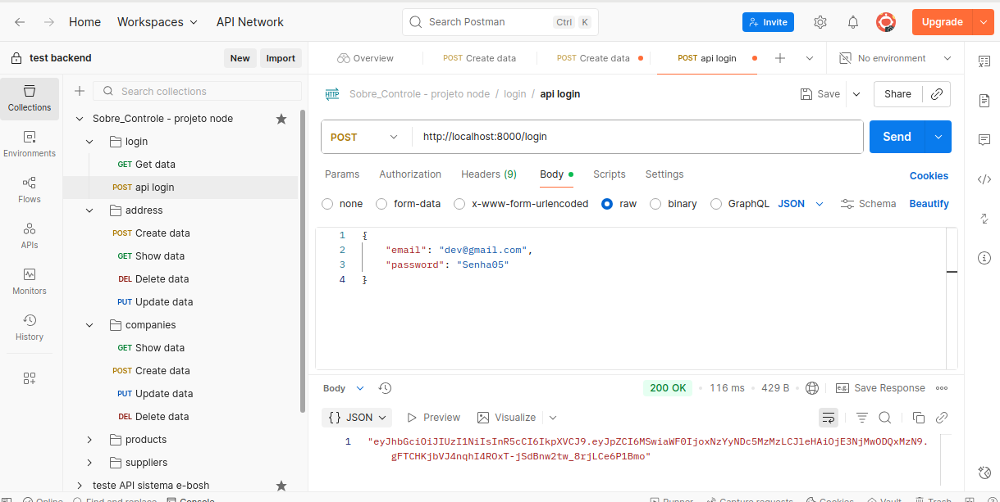
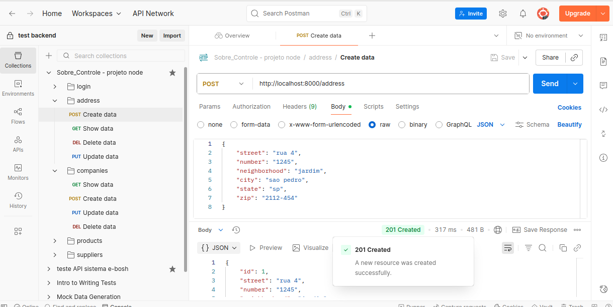
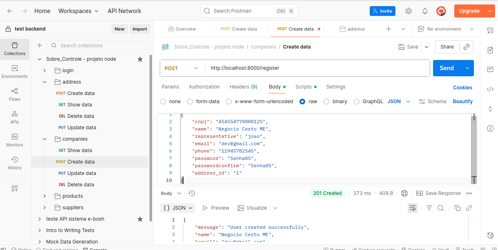

# 📦 Sobre Controle – Backend Node.js

Este repositório apresenta o backend de um sistema Full-stack Web desenvolvido para atender à necessidade de melhorar o controle de clientes, fornecedores e produtos em ambientes comerciais. A aplicação foi criada com foco em gestão eficiente, segurança de dados e tomada de decisão baseada em informações confiáveis.

O sistema tem como finalidade:

- Gerenciar o cadastro de produtos e os clientes que os consomem
- Controlar matérias-primas e os fornecedores que as fornecem
- Facilitar a emissão de relatórios gerenciais
- Otimizar o controle de gastos
- Organizar e manter a gestão de contatos comerciais

Construído com Node.js e Express, utilizando Sequelize como ORM e PostgreSQL como banco de dados, este backend reflete um compromisso com boas práticas de engenharia de software, arquitetura escalável e código limpo, aplicando conceitos modernos como autenticação com JWT, validação com Yup, e logging com Winston.

## 🚀 Tecnologias Utilizadas

- Backend: Node.js, Express.js
- ORM: Sequelize
- Banco de Dados: PostgreSQL
- Autenticação: JWT (JSON Web Tokens)
- Validação: Yup
- Segurança: Bcrypt (hash de senhas)
- Logging: Winston
- Variáveis de Ambiente: Dotenv
- Padrões de Código: ES Modules, Eslint
- Configuração: Dotenv, CORS
- gerenciar de pacotes: Yarn

## 🧱 Arquitetura e Boas Práticas

O projeto segue a arquitetura MVC (Model-View-Controller), promovendo separação de responsabilidades e facilitando manutenção e escalabilidade. Algumas práticas adotadas:

- Logger centralizado com Winston para monitoramento e depuração
- Uso de async/await para controle assíncrono limpo
- Tratamento de erros padronizado para respostas consistentes
- Validação com Yup para garantir integridade dos dados
- Autenticação com JWT e hash de senhas com Bcrypt
- Variáveis de ambiente (.env) para segurança e flexibilidade
- CORS configurado para aceitar requisições apenas de origens seguras
- ESLint para padronização e qualidade de código

## 🛠️ Como Rodar o Projeto

```
# Clone o repositório:
 git clone https://github.com/DAVI-RJ/backend_node.js

# Instale as dependências
yarn install #ou npm install
```

#### Configuração do Banco de Dados (.env):

Este projeto utiliza o Sequelize como ORM. Você precisará criar um arquivo .env na raiz do projeto com as credenciais do seu banco de dados e outras configurações essenciais.

```
 Exemplo de .env:
 	DB_HOST=localhost
  	DB_USER=seu_usuario
  	DB_PASS=sua_senha
  	DB_NAME=seu_banco_de_dados
  	DB_DIALECT=postgres
  JWT_SECRET=sua_chave_secreta_jwt
  PORT=3000
```

As configurações específicas do Sequelize, como as definidas no config/config.js (geradas pelo Sequelize-CLI), devem ser ajustadas conforme seu ambiente local e sistema operacional. Cada ambiente pode ter variações em como o banco de dados é acessado.

-Execute as migrações do banco de dados (se aplicável):

```
 npx (yarn ou npm) sequelize-cli db:migrate

```

#### Inicie o servidor:

```
 yarn run dev

```

O servidor estará rodando em http://localhost:[PORTA_CONFIGURADA_NO_ENV].

## 🧪 Testes e Qualidade

Teste feitos com o postman

#### 🐞 Demonstração teste funcionais com prints

Para ter uma visão rápida das funcionalidades principais do projeto em ação e como as APIs se comportam, confira as demonstrações abaixo:

- login empresa:
  
- Cadastro de endereço:
  
- Cadastro de usuário:
  

## 📚 Aprendizados e Desafios

Este projeto nasceu como um exercício de aprendizado e evoluiu para um backend robusto. Durante o desenvolvimento, enfrentei desafios como:

- Migração de CommonJS para ES Modules, conciliando com ferramentas como sequelize-cli

- Entendimento profundo de separação de responsabilidades, clean code e design patterns

- Refatoração contínua para melhorar legibilidade, nomeação de variáveis e modularidade

Cada decisão técnica foi tomada com base em boas práticas e na busca por um código limpo, escalável e fácil de manter.
